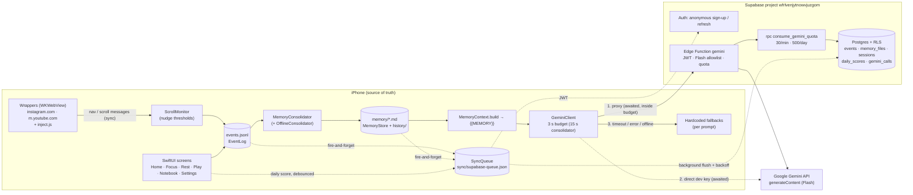
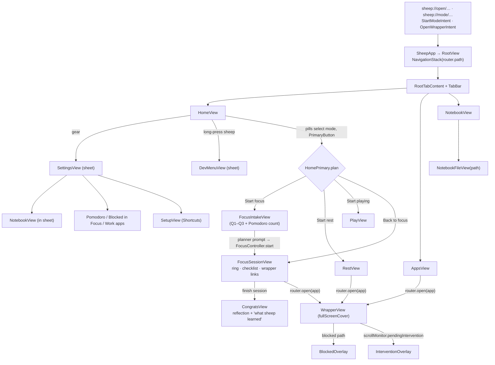
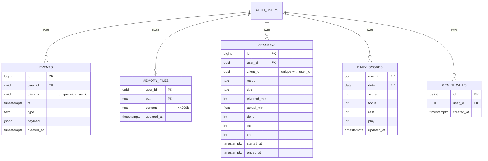
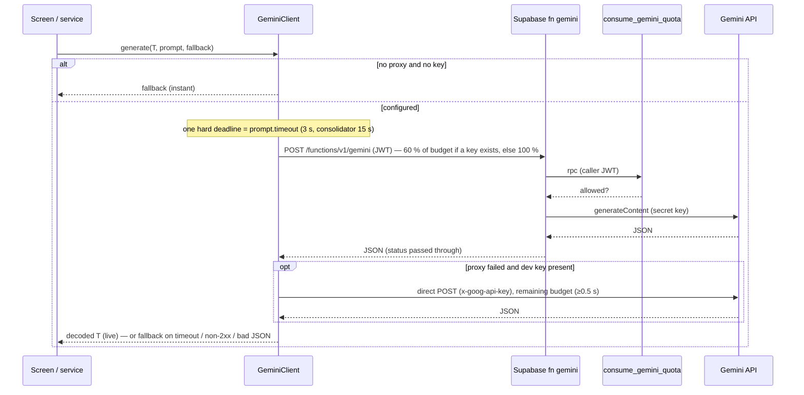
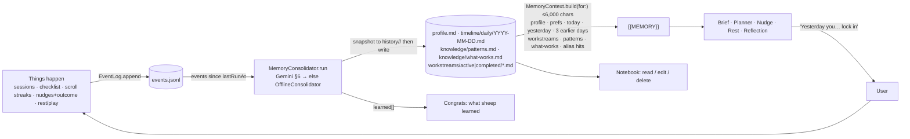

# Sheep — architecture (as built on `main` @ `e0bacca`, 24 Oct 2026)

This document describes what the code on `origin/main` actually does. The specs (`docs/BUILD_PROMPT.md`, `docs/MVP_PLAN.md`, `docs/GEMINI_PROMPTS.md`) describe intent; **where they disagree with the code, the code wins and the gap is called out** (look for "⚠️ Docs vs code").

An interactive version of this page lives at [`docs/architecture.html`](architecture.html) (open it in any browser, works offline).

**Glossary (plain English)**

| Term | Meaning |
|---|---|
| SwiftUI | Apple's UI framework; every screen is a Swift `View`. |
| Web-view wrapper | Sheep shows Instagram/YouTube's *mobile websites* inside its own browser view (`WKWebView`) so it can watch which page you're on and hide parts of it. |
| Deep link | A URL like `sheep://mode/focus` that opens the app at a specific place (used by iOS Shortcuts). |
| App Intent | An action Sheep publishes to the iOS Shortcuts app ("Start Focus in Sheep"). Needs no paid entitlement. |
| Supabase | Hosted Postgres database + auth + serverless functions. Sheep's backend. |
| Anonymous auth | Supabase gives each install a user id with no email/password, so rows can be private per device. |
| RLS (row-level security) | Postgres rules that let each user read/write only rows whose `user_id` is their own. |
| Edge Function | A small server-side TypeScript function hosted by Supabase (here: `gemini`, which forwards prompts to Google). |
| Fire-and-forget | The app hands data to a background queue and never waits for the network. |
| Fallback | Hand-written text used when Gemini can't answer in time — the demo never depends on Wi-Fi. |
| Event log | `events.jsonl`: one line of JSON per thing that happened (session start, scroll streak, nudge…). |
| Consolidator | A background job that reads new events and rewrites the markdown "memory" files. |

---

## 1. System map

* **Solid arrows** happen while the user waits (bounded by the prompt timeout). **Dotted arrows** are background-only: nothing in the UI ever awaits them.
* **Offline**: `SupabaseClient.shared` is `nil` with no `SUPABASE_HOST`/`SUPABASE_ANON_KEY` → `GeminiClient` with no key and no proxy returns every fallback instantly; sync hooks are no-ops. With config but no network, `SupabaseTransport` marks itself offline for 15 s so later calls fail instantly, the sync queue keeps every op on disk (bounded to 1,000) and retries with backoff when the app comes back to the foreground.

## 2. Frontend

### 2.1 Navigation

`Route` (in `Sheep/State/Router.swift`) = `focusIntake, focusSession, congrats, rest, play, notebook, setup, notebookFile(String)`. `Router` also owns `presentedWrapper`, `showDevMenu`, `showSettings`, and `tab` (`home | apps | notebook`).

**Real vs placeholder:** `Sheep/Views/Placeholders/` no longer exists — every placeholder screen has been replaced with a real implementation. There are no stub screens left on `main`.

Key behaviours:
- **One mode at a time.** `HomePrimary.plan` never ends a running Focus from Home (button reads "Back to focus"); starting Rest/Play/Focus ends a running Rest/Play through `RestController` first. Deep links go through the same code (`ModeSwitch.swift`).
- **Focus session never auto-finishes**: when time is up the ring says to tick what you finished; the user taps "finish session".
- **Dev menu** (long-press the sheep): fast timers toggle, seed yesterday, run consolidator, reset all, and a status line showing whether Gemini goes "via supabase" or "via key" or "not configured — fallbacks".

### 2.2 Building blocks
| Block | File | What it gives you |
|---|---|---|
| `Theme` | `Sheep/Design/Theme.swift` | Nunito via the `wght` axis (min 400), type scale from Paper, foggy-field palette (light + dark), mode accents (Focus `#3D5AFE`, Rest `#2E7D5B`, Play `#E8A93B`), 24 pt margins, 8 pt grid, `Theme.spring` (0.4 s). |
| `Components` | `Sheep/Views/Components/Components.swift` | `PrimaryButton`, `TextButton`, `Hairline`, `ModeDot`, `Caption`, `SectionLabel`, `Surface`, `IconCircleButton`, `Screen` (custom header, keeps swipe-back). |
| `SheepView` | `Sheep/Views/SheepView.swift` | Hero art per mode (awake/focus/rest; **Play falls back to awake**), wool puff for stages 0–4, wool-shed animation when XP drops. |
| `AppState` | `Sheep/State/AppState.swift` | `@Observable` mode, `Progress` (XP), active Focus/Rest/Play sessions, last outcome, `fastTimers`; persisted to UserDefaults `sheep.appState.v1`. Owns the `ScrollMonitor`. |
| `SheepSettings` | `Sheep/State/Settings.swift` | Voice (Lock in / Gentle), ask-before-acting, Pomodoro 15/25/50, blocked-in-Focus sections, muted work apps — all `sheep.*` UserDefaults keys. |

## 3. Mode policy (from `Sheep/State/Policy.swift` + `ScrollMonitor.threshold`)

| Section | Focus | Rest | Play | Idle |
|---|---|---|---|---|
| Instagram feed `/` | allowed · nudge after 30 s (fast) / 3 min | allowed · nudge after 2 min (fast) / 30 min | allowed · never nudged | allowed · never nudged |
| Instagram Reels `/reels/`, `/reel/…`, `/<user>/reels/` | **blocked** (URL + hidden links)* | allowed · Rest nudge | allowed | allowed |
| Instagram DMs `/direct/…` | **blocked*** | allowed | allowed | allowed |
| YouTube feed | allowed · Focus nudge | allowed · Rest nudge | allowed | allowed |
| YouTube Shorts `/shorts/…` | **blocked*** | allowed · Rest nudge | allowed | allowed |
| Work apps (Teams/Outlook/Slack) | — | shown "muted" (display only; real muting = user's iOS Focus Shortcut) | shown "muted" | — |

\* Focus blocks Reels, DMs and Shorts by default; the user can untick any of them in Settings → "Blocked in Focus" (`sheep.blockedInFocus`). The feed can never be blocked. Blocking happens two ways: `WrapperNavigation.decide` cancels full page loads in `decidePolicyFor`, and `inject.js` reports SPA (single-page-app) `pushState` navigations so native shows `BlockedOverlay` and goes back. `Policy.hidingCSS` hides the entry links cosmetically. Nudge cooldown is 120 s; a nudge resolves as `returned` if the user taps a leaving action, opens DMs, or leaves the wrapper within 60 s, else `ignored` (+15 / −10 XP).

⚠️ Docs vs code: MVP_PLAN says Rest monitors the feed "lenient" and Reels "monitored" — code uses one Rest threshold for every section. Play/Idle are never nudged.

## 4. Backend

### 4.1 Tables (`supabase/migrations/20261024171408_sheep_backend.sql`)

| Table | Grants to `authenticated` (anon gets nothing) | RLS policies (all `to authenticated`, `(select auth.uid()) = user_id`) |
|---|---|---|
| `events` | select, insert | select own, insert own (append-only) |
| `memory_files` | select, insert, update, delete | all four, own rows |
| `sessions` | select, insert, update | select/insert/update own |
| `daily_scores` | select, insert, update | select/insert/update own |
| `gemini_calls` | select, insert, delete | select/insert own; delete own **only rows older than 1 day** (so you can't reset your quota) |

`user_id` defaults to `auth.uid()` so the app never sends it. Every FK cascades on user delete. `consume_gemini_quota(per_minute=30, per_day=500)` is `security invoker` (RLS still applies), takes a per-user advisory lock, prunes rows older than 2 days, and callers can only *lower* the limits (`least(…, 30)` / `least(…, 500)`). Execute is granted to `authenticated` only.

### 4.2 Edge Function `gemini` (`supabase/functions/gemini/handler.ts`)
1. `OPTIONS` → 204 (CORS); non-POST → 405.
2. Platform `verify_jwt = true` (`supabase/config.toml`) — only signed-in (anonymous) users reach the code.
3. No `GEMINI_API_KEY` secret → 503. Body > 256 KB → 413. Not a JSON object / no `contents` → 400.
4. `model` must be in the Flash allowlist (`gemini-flash-latest`, `gemini-flash-lite-latest`, `gemini-2.5-flash(-lite)`, `gemini-2.0-flash(-lite)`, `gemini-3-flash-preview`) → else 400.
5. Calls `rpc/consume_gemini_quota` **with the caller's JWT** (3 s timeout). Failure → 503; over limit → 429.
6. Forwards only `contents`, `systemInstruction`, `generationConfig` to `generativelanguage.googleapis.com/v1beta/models/{model}:generateContent` with the secret key; 15 s upstream timeout (504), network error → 502. Gemini's status code is passed through.

Tests: `supabase/functions/gemini/handler_test.ts` (`deno test supabase/functions/gemini/`).

### 4.3 Swift client (`Sheep/Services/Supabase/`)
- `SupabaseConfig` reads `SUPABASE_HOST` (bare host) + `SUPABASE_ANON_KEY` from Info.plist (fed by git-ignored `Config/Secrets.xcconfig`).
- `SupabaseAuth` (actor): anonymous `POST /auth/v1/signup`, refresh via `/auth/v1/token?grant_type=refresh_token`, session in UserDefaults `sheep.supabase.session.<host>`; revoked refresh → new anonymous user; sign-up failures back off 60 s.
- `SupabaseTransport`: ephemeral URLSession, 10 s request timeout, remembers connectivity failures for 15 s.
- `SupabaseClient`: PostgREST upsert/delete + function invoke, retries once on 401; conforms to `GeminiProxying` (adds `model` to the body) and `SyncSending`.
- `SupabaseSync.shared` hooks: `record(event)` (from `EventLog.append`), `memoryWritten/memoryDeleted` (from `MemoryStore`), `recordDailyScore` (from `DailyScoreSync`, debounced 2 s from Home). A `session_start` is remembered and paired with the next `session_end` to write a `sessions` row.
- `SyncQueue`: persisted FIFO JSON file, coalesces by key (latest memory-file write wins), batches up to 50 upserts per request, backoff 2 s → 10 min, drops permanent 4xx errors or after 12 attempts; connectivity/auth failures are never dropped.

⚠️ Code gap: the `sessions` comment says "Focus / Rest / Play", but only `session_end` (Focus) creates a row; `rest_activity` / `play_session` only reach `events`.

### 4.4 `GeminiClient` call order (`Sheep/Services/GeminiClient.swift`)

Schemas are written lower-case in Swift and upper-cased by `JSONValue.geminiSchema`. Default model `gemini-flash-latest` (override `GEMINI_MODEL`). `withDeadline` guarantees the return even if a request ignores cancellation.

## 5. AI + memory loop

| # | Prompt file | Fires when | Input (besides `{{MEMORY}}`) | Output | Offline fallback |
|---|---|---|---|---|---|
| 1 | `DailyBriefPrompt` | Home appears / daily rollover / seed / reset (`DailyBriefService`, cached per day) | NOW (weekday, date, time, tz) | headline, body, suggestedMode | `OfflineBrief` from yesterday's events + nearest workstream deadline ("Yesterday you did 1 of 3 Pomodoros before Reels got you at 22:40. Lock in — Dissertation ch.3 is due Friday.") or "How to start" |
| 2 | `PlannerPrompt` | Intake "plan" (`FocusController.makePlan`) | session length, Pomodoros, Q1–Q3, NOW | title, opener, checklist 3–5, watchOut, workstream | Built from answers + workstream next step + yesterday recap; checklist always 3–5 |
| 3 | `NudgePrompt` | Scroll streak crosses threshold (`ScrollMonitor`) | mode, app, section, minutes, nudges so far, goal, checklist, min left, voice | headline, message, primaryAction, primaryLabel, tone | Per-mode copy naming the goal and minutes (firm / gentle / playful) |
| 4 | `RestNudgePrompt` | Rest started (`RestController.scheduleRestNudge`); fallback scheduled at once, Gemini text replaces it if it arrives | activity, limit, projected actual, NOW | title, body (notification) | "that was a good rest — 50 min of netflix, past your 45…" |
| 5 | `ReflectionPrompt` | Finish session (`FocusController.finish`, in parallel with consolidation) | title, planned/actual, checklist, nudges, scroll minutes | headline, summary, xpBonus 0–50, nextStep | Honest rule-based card + bonus |
| 6 | `ConsolidatorPrompt` (no Persona, 15 s) | Session end + first open of a new day + dev button | all memory files + new JSONL events | files[{path, content, op}], learned[≤3] | `OfflineConsolidator` (deterministic: daily timeline, patterns, what-works, workstream progress, learned lines) |

Play has **no** Gemini call: its over-limit notification is the fixed `RestController.playFallback`.

How "yesterday you… lock in" happens: yesterday's events are rendered into `timeline/daily/<yesterday>.md` (on session end, or on the first `.active` of a new day via `DailyRollover`). `MemoryContext.build` always puts the "Yesterday (Friday 2026-10-23)" block near the top of `{{MEMORY}}`, and the Persona tells Gemini to bring it up. If Gemini is unreachable, `OfflineBrief.recapSentence` builds the same sentence straight from the raw events, so the line still appears offline.

## 6. One demo run, step by step
1. **Seed yesterday** (dev menu, or `-sheepSeedYesterday` launch arg in DEBUG): `MemorySeeder` writes 8 yesterday events (21:05 Focus "Dissertation ch.3 intro" 75 min planned, Reels 4.5 min + ignored firm nudge, 1/3 done, Reels 12 min at 22:40 + returned playful nudge, Netflix 110/45 min), plus `profile.md`, the daily file, `patterns.md`, `what-works.md`, `workstreams/active/dissertation-ch3.md` (due next Friday). Sets `lastRunAt` so the consolidator won't redo it. Brief cache invalidated → Home card: "Yesterday you did 1 of 3 Pomodoros before Reels got you at 22:40…". Every file write and event is queued for Supabase.
2. **Focus**: Home → "Start focus" → intake pre-fills Q1 from the workstream → planner (≤3 s) → `FocusController.start` logs `session_start`, schedules Pomodoro notifications (1 min each with fast timers), mode = focus, wrappers now block Reels/DMs/Shorts.
3. **Scroll Reels** → blocked: `BlockedOverlay` ("Not now — you're focusing on …"), `blocked` event. Scroll the feed → `inject.js` posts scroll samples every 5 s → after 30 s (fast) `ScrollMonitor` calls the nudge prompt → `InterventionOverlay`.
4. **Nudge outcome**: "back to focus" → `nudge` event `returned`, +15 XP, `nudgesResisted++`, route back to the session. Ignoring it for 60 s → `ignored`, −10 XP, wool sheds.
5. **Tick checklist** (+20 XP each, `checklist_done`) → **finish session** → `session_end` logged, Congrats shows instantly with the offline card and XP (minute blocks + 50 if complete + bonus); reflection and consolidation run in parallel and patch the card ("what sheep learned").
6. **Memory update**: consolidator rewrites today's daily file, patterns, what-works and workstream progress (history snapshot first) → `.memoryDidChange` → Home score/brief recompute.
7. **Supabase sync** (background): rows for `events`, `memory_files`, one `sessions` row, and the debounced `daily_scores` row upsert via `SyncQueue`.
8. **Rest** → pick Netflix 45 min → notification after 20 s real time ("50 min of netflix, past your 45…"), DMs open in the wrapper. **Play** → timer, muted work apps, +10 XP if ended under the limit.

## 7. Status board

| Area | Status | Notes |
|---|---|---|
| Wrappers, URL blocking, CSS hiding, login hosts | ✅ Done (#11, #19) | IG/YouTube mobile web; login via Facebook/Google stays in-wrapper. Needs network and a real login. |
| Focus flow intake → plan → Pomodoro → congrats | ✅ Done (#17) | No auto-finish (by design). |
| Doom-scroll nudge | ✅ Done (#4) | |
| Rest & Play | ✅ Done (#10) | Play has no Gemini text. |
| Memory: store, consolidator, context, daily brief, seed | ✅ Done (#9) | Offline consolidator mirrors the Gemini output format. |
| Notebook | ✅ Done (#6) | |
| XP & wool | ✅ Done (#8, #14) | Wool thresholds 50/150/300/500. |
| Shortcuts, deep links, App Intents | ✅ Done (#7) | User must build the automations by hand. |
| Home/Settings redesign, Apps tab, score | ✅ Done (#13, #19) | |
| Supabase backend code | ✅ Code merged (#12) | See deployment below. |
| Supabase deployment | ❌ Gemini function **not deployed**; tables unverified | Unauthenticated `POST https://wfrlvenjytnowvjuzgom.supabase.co/functions/v1/gemini` → `404 NOT_FOUND "Requested function was not found"` (24 Oct). The Supabase MCP returned "no permission" for list_tables / list_migrations / list_edge_functions, so the tables and migration are **unverified**. |
| Animated sheep | 🟡 Open PR #16 | Not wired into `SheepView`. |
| Acceptance UI test (demo script offline) | 🟡 Open PR #18 | Adds `SheepUITests`, debug launch hooks, `-sheepOffline`. |
| Play/controller sheep art | ❌ Missing | `SheepArt` maps `.play` → `sheep-awake` (TODO in `SheepView.swift`). |
| Brief refresh button (BUILD_PROMPT step 6) | ❌ Not built | Brief refreshes on rollover/seed/reset only. |
| Backup video, Devpost, pitch | ❓ Not in repo | |

Known issues / risks:
- **Gemini key 403 `API_KEY_SERVICE_BLOCKED`** (reported by the user, not reproduced here): with it, every live call fails and the app silently uses fallbacks. The same key is needed as the Supabase secret `GEMINI_API_KEY`.
- With Supabase configured but the function missing, every Gemini call spends 60 % of its 3 s budget on a 404 before trying the direct key — slower, still safe.
- The direct `GEMINI_API_KEY` is copied into Info.plist, so it ships inside any build that has it set. Dev only; rotate the key after the event.
- `config.toml` caps anonymous sign-ins at 30/hour per IP (local config; hosted setting unverified) — repeated resets on venue Wi-Fi could hit it (sync just backs off).
- `sessions` only gets Focus rows.

⚠️ Other docs-vs-code differences:
- MVP_PLAN says "backend, accounts: out of scope" and "Gemini called directly from the app". The code uses Supabase as the default path, with the direct key as a dev fallback (BUILD_PROMPT and CLAUDE.md were updated; MVP_PLAN was not).
- BUILD_PROMPT gives Play accent `#E07A2E` and a "warm off-white" background. Code/Paper use `#E8A93B` and fog `#ECEDEB`.
- BUILD_PROMPT's Theme sample uses weights 600/700. The real scale is 400–900 (no thin type).
- MVP_PLAN's memory budget is "≤ ~1.5k tokens". Code caps at 6,000 characters (about the same).
- A nudge resolves as "returned" on leaving the wrapper, a leaving button, or opening DMs; moving from the feed to Reels/Shorts does **not** count.

## 8. File index

### `Sheep/`
| File | One line |
|---|---|
| `SheepApp.swift` | App entry; injects `AppState`/`Router`, starts notifications + `SupabaseSync`, deep links, daily rollover; `RootView` routes, wrapper cover, dev/settings sheets. |
| `Design/Theme.swift` | Nunito-by-weight helper, type scale, palette (light/dark), accents, spacing, spring. |
| `Intents/IntentRouter.swift` | `DeepLink` URL builders + hand-off from App Intents to the running UI. |
| `Intents/SheepIntents.swift` | `StartModeIntent`, `OpenWrapperIntent`, `SheepShortcuts` (Siri/Shortcuts phrases). |
| `Memory/DailyBriefService.swift` | Home brief: per-day cache, Gemini §1 → `OfflineBrief` fallback. |
| `Memory/MemoryConsolidator.swift` | Write path: serialised runs, Gemini §6 or offline, applies files, stores `learned`. |
| `Memory/MemoryContext.swift` | Read path: builds `{{MEMORY}}` (≤6,000 chars) per `MemoryPurpose`. |
| `Memory/MemoryHeader.swift` | YAML header parse/serialise, `MemoryFile` title/body, `MemoryDates`. |
| `Memory/MemorySeeder.swift` | "Seed yesterday", `MemoryReset` (forget everything), `DailyRollover`. |
| `Memory/MemoryStore.swift` | Markdown files under `Documents/memory/`, path safety, history snapshots, alias search, sync hooks. |
| `Memory/OfflineConsolidator.swift` | Deterministic consolidation: daily renderer, patterns, what-works, workstreams, learned lines. |
| `Models/DayScore.swift` | Per-mode 0–100 daily scores from events + delta vs yesterday. |
| `Models/Mode.swift` | `Mode` idle/focus/rest/play, accent + on-accent colours. |
| `Models/Progress.swift` | XP, level, wool stage thresholds. |
| `Models/Session.swift` | `FocusSession`, `ChecklistItem`, `SessionOutcome`, `RestSession`, `PlaySession`. |
| `Models/WrappedApp.swift` | `WrappedApp` (Instagram/YouTube URLs, hosts), `AppSection`. |
| `Models/XPRules.swift` | All XP amounts and formulas. |
| `Resources/Fonts/` | Nunito variable fonts + `OFL.txt` licence. |
| `Assets.xcassets/Sheep/` | `sheep-awake`, `sheep-focus`, `sheep-rest` (no `sheep-play`). |
| `Services/AppPaths.swift` | Documents root, `memory/`, `events.jsonl`, `history/`. |
| `Services/Deadline.swift` | `withDeadline`: hard timeout even for non-cancellable work. |
| `Services/EventLog.swift` | `SheepEvent` schema + thread-safe JSONL append/read; mirrors to Supabase. |
| `Services/FocusController.swift` | Plan, start, checklist toggle, finish (XP, congrats, reflection + consolidation). |
| `Services/GeminiClient.swift` | `JSONValue`, `GeminiPrompt`, proxy → key → fallback chain. |
| `Services/NotificationService.swift` | Local notifications (schedule/cancel, show banners in-app). |
| `Services/PomodoroTimer.swift` | Wall-clock Pomodoro maths + per-Pomodoro notifications. |
| `Services/RestController.swift` | Rest/Play start/end, `LimitClock` (fast demo time), overuse notifications. |
| `Services/ScrollMonitor.swift` | Scroll streaks, thresholds, cooldown, nudge request, outcome + XP. |
| `Services/Prompts/Persona.swift` | Sheep persona text + `PromptClock`. |
| `Services/Prompts/DailyBriefPrompt.swift` | §1 system/schema/template + first-day fallback. |
| `Services/Prompts/PlannerPrompt.swift` | §2 planner + offline plan + `ActiveWorkstream` parser. |
| `Services/Prompts/NudgePrompt.swift` | §3 nudge, `NudgeAction`/`NudgeTone`/`NudgeInput`, fallbacks. |
| `Services/Prompts/RestNudgePrompt.swift` | §4 rest overuse notification + fallback. |
| `Services/Prompts/ReflectionPrompt.swift` | §5 congrats reflection + honest fallback. |
| `Services/Prompts/ConsolidatorPrompt.swift` | §6 consolidator (no persona, 15 s) + `ConsolidatorResponse`. |
| `Services/Supabase/SupabaseConfig.swift` | Host/anon key from Info.plist; `RuntimeEnvironment.isRunningTests`. |
| `Services/Supabase/SupabaseAuth.swift` | `SupabaseSession`, `SupabaseTransport` (offline memory), anonymous auth actor. |
| `Services/Supabase/SupabaseClient.swift` | REST upsert/delete, function invoke, Gemini proxy. |
| `Services/Supabase/SupabaseRequests.swift` | Pure request builders + `SupabaseError`. |
| `Services/Supabase/SupabaseSync.swift` | Row encoders + fire-and-forget hooks + flush scheduling. |
| `Services/Supabase/SyncQueue.swift` | Persisted, coalescing, batched retry queue. |
| `Services/Supabase/DailyScoreSync.swift` | Debounced daily score upload from Home. |
| `State/AppState.swift` | Observable app state persisted to UserDefaults. |
| `State/AppReset.swift` | Dev "reset all" (keeps the Supabase identity). |
| `State/ModeSwitch.swift` | Applies a `HomePrimary.Plan`; `sheep://mode/idle` stop. |
| `State/Policy.swift` | Section detection, what each mode blocks, hiding CSS, host checks. |
| `State/Router.swift` | `Route`, `HomeTab`, `Router` + deep-link handling. |
| `State/Settings.swift` | `SheepSettings` / `SheepVoice` preferences. |
| `Views/HomeView.swift` | Home screen + `HomePrimary` button logic. |
| `Views/Home/AppsView.swift` | Apps tab: wrapped apps with "hidden in this mode" captions, muted work apps. |
| `Views/Home/ModePills.swift` | Focus/Rest/Play pills with per-mode scores. |
| `Views/Home/RestBrief.swift` | Rest-pill message from today's real numbers. |
| `Views/Home/ScoreHeader.swift` | Mode label, big score, delta. |
| `Views/Home/SheepMessageCard.swift` | `HomeMessage` + white message card. |
| `Views/Home/TabBar.swift` | `RootTabContent` + floating tab bar. |
| `Views/FocusIntakeView.swift` | Three questions + Pomodoro count, pre-filled from workstream. |
| `Views/FocusSessionView.swift` | Ring, plan, checklist, wrapper links, finish. |
| `Views/CongratsView.swift` | Reflection, XP, wool, "what sheep learned". |
| `Views/RestView.swift` | Activity + limit picker, timer, wrapper links, muted apps. |
| `Views/PlayView.swift` | Play timer, muted apps, XP. |
| `Views/InterventionOverlay.swift` | Nudge overlay over the wrapper. |
| `Views/NotebookView.swift` | Memory files grouped by section. |
| `Views/NotebookFileView.swift` | View/edit/delete one memory file; markdown renderer. |
| `Views/NotebookModel.swift` | Pure grouping/titling/markdown-block logic. |
| `Views/SettingsView.swift` | Settings sheet (Sheep, Modes, Privacy groups). |
| `Views/Settings/SettingsDetailViews.swift` | Pomodoro length, blocked in Focus, muted work apps pickers. |
| `Views/SetupView.swift` | Shortcuts automations guide + deep links; `ShortcutsDone`. |
| `Views/SheepView.swift` | Hero sheep art, wool puff, wool shed. |
| `Views/DevMenuView.swift` | Hidden dev menu + `DevActions`. |
| `Views/Components/Components.swift` | Shared buttons, labels, `Surface`, `Screen`. |
| `Views/Components/FlatGroup.swift` | Flat list section + `RowChevron`. |
| `Views/Components/MutedAppsList.swift` | "Muted" work apps list (display only). |
| `Views/Components/XPChangeLabel.swift` | Floating "+20 xp" label. |
| `Wrapper/WrapperView.swift` | Full-screen wrapper chrome + overlays. |
| `Wrapper/WebView.swift` | `WrapperController` (WKWebView, scripts, policy, ScrollMonitor wiring), `WrapperMessage`. |
| `Wrapper/WrapperNavigation.swift` | Pure allow/block/Safari decisions + login hosts. |
| `Wrapper/BlockedOverlay.swift` | "Not now" overlay for blocked sections. |
| `Wrapper/inject.js` | Path watcher, scroll reporter, `__sheepSetCSS`. Never reads page content. |

### `supabase/`
| File | One line |
|---|---|
| `config.toml` | Local CLI config: anonymous sign-ins on, `[functions.gemini] verify_jwt = true`. |
| `migrations/20261024171408_sheep_backend.sql` | Five tables, RLS, grants, `consume_gemini_quota`. |
| `functions/gemini/index.ts` | `Deno.serve` entrypoint. |
| `functions/gemini/handler.ts` | Proxy logic (allowlist, quota, field filter, timeouts). |
| `functions/gemini/handler_test.ts` | Deno unit tests for the handler. |
| `.gitignore` | Ignores local Supabase artefacts. |

Tests: 213 XCTest functions across 12 files in `SheepTests/` (largest: `SupabaseTests` 33, `InterventionTests` 28, `HomeTests` 23).
